# Unidentified compressed streams

Made by `tools/stream_catalog.py`; do not edit. These streams are carved
(labelled, and placed by the build) but not identified: each is still the
ROM's bytes, `gcUnknownADDR.comp`. When the code that uses one is read, give it
a real name and format (a PNG if it is graphics) and run the tool again.

Previews draw the decompressed bytes as 4bpp tiles, 16 across, in grey. That
is only a first look: a stream may be 2bpp graphics, a tilemap, or other data.

243 streams.

## Region $9C8000

### gcUnknown9C8000

14605 bytes compressed, 18432 decompressed.
- `rlUnknown91D6EC` (engine/unsorted/bank91.asm:1871): `lda #(`gcUnknown9C8000)<<8`

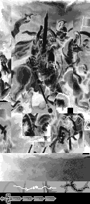

### gcUnknown9CB90D

531 bytes compressed, 2048 decompressed.
- `rlUnknown91D6EC` (engine/unsorted/bank91.asm:1849): `lda #(`gcUnknown9CB90D)<<8`
- `rsUnknown91E583` (engine/unsorted/bank91.asm:4192): `lda #(`gcUnknown9CB90D)<<8`
- `rlUnknown91E793` (engine/unsorted/bank91.asm:4591): `lda #(`gcUnknown9CB90D)<<8`
- `rlUnknown91E82A` (engine/unsorted/bank91.asm:4660): `lda #(`gcUnknown9CB90D)<<8`

### gcUnknown9CBB20

151 bytes compressed, 2048 decompressed.
- `rlUnknown91D6EC` (engine/unsorted/bank91.asm:1884): `lda #(`gcUnknown9CBB20)<<8`
- `rsUnknown91E5B2` (engine/unsorted/bank91.asm:4228): `lda #(`gcUnknown9CBB20)<<8`

### gcUnknown9CBBB7

1002 bytes compressed, 2048 decompressed.
- `rlUnknown91D6EC` (engine/unsorted/bank91.asm:1897): `lda #(`gcUnknown9CBBB7)<<8`
- `rsUnknown91E5F4` (engine/unsorted/bank91.asm:4260): `lda #(`gcUnknown9CBBB7)<<8`

### gcUnknown9CBFA1

275 bytes compressed, 512 decompressed.
- `rlUnknown91D6EC` (engine/unsorted/bank91.asm:1910): `lda #(`gcUnknown9CBFA1)<<8`
- `rsUnknown91E622` (engine/unsorted/bank91.asm:4292): `lda #(`gcUnknown9CBFA1)<<8`

### gcUnknown9CC0B4

2734 bytes compressed, 8192 decompressed.
- `rlUnknown91E793` (engine/unsorted/bank91.asm:4604): `lda #(`gcUnknown9CC0B4)<<8`

### gcUnknown9CCB62

688 bytes compressed, 2048 decompressed.
- `rlUnknown91E793` (engine/unsorted/bank91.asm:4617): `lda #(`gcUnknown9CCB62)<<8`

### gcUnknown9CCE12

2311 bytes compressed, 8192 decompressed.
- `rlUnknown91E82A` (engine/unsorted/bank91.asm:4673): `lda #(`gcUnknown9CCE12)<<8`

### gcUnknown9CD719

509 bytes compressed, 2048 decompressed.
- `rlUnknown91E82A` (engine/unsorted/bank91.asm:4686): `lda #(`gcUnknown9CD719)<<8`

### gcUnknown9CD916

72 bytes compressed, 512 decompressed.
- `rlUnknown91E793` (engine/unsorted/bank91.asm:4630): `lda #(`gcUnknown9CD916)<<8`
- `rlUnknown91E82A` (engine/unsorted/bank91.asm:4699): `lda #(`gcUnknown9CD916)<<8`

## Region $A08000

### gcUnknownACC8C3

852 bytes compressed, 8192 decompressed.
Nothing in the source names it (found between other streams).

### gcUnknownACCC17

1797 bytes compressed, 8192 decompressed.
- `rlUnknown9E88FA` (engine/unsorted/bank9E.asm:1708): `lda #(`gcUnknownACCC17)<<8`
- `rlProcUnknown9E9A43Cycle1` (engine/unsorted/bank9E.asm:4667): `lda #(`gcUnknownACCC17)<<8`
- `rlUnknown9ED2B5` (engine/unsorted/bank9E.asm:10606): `lda #(`gcUnknownACCC17)<<8`
- `rlProcUnknown9ED441Cycle1` (engine/unsorted/bank9E.asm:11094): `lda #(`gcUnknownACCC17)<<8`
- `rlProcUnknown9EF837Cycle1` (engine/events/cutscenes.asm:472): `lda #(`gcUnknownACCC17)<<8`

## Region $C00A2B

### gcUnknownC00A2B

3920 bytes compressed, 6144 decompressed.
- `rlUnknown80B0D3` (engine/unsorted/bank80.asm:4464): `lda #(`gcUnknownC00A2B)<<8`
- Entry `aUnknown80E53D` (engine/unsorted/bank80.asm:6978): $1800 bytes to VRAM $4000; used by `rsUnknown80E4EB` (engine/unsorted/bank80.asm:6940).
- `rlUnknown9EA155` (engine/unsorted/bank9E.asm:5372): `lda #(`gcUnknownC00A2B)<<8`
- Entry `aUnknown80E13E` (engine/menus/revive_screen.asm:218): $1800 bytes to VRAM $0000; used by `rsUnknown80E0AE` (engine/menus/revive_screen.asm:154).
- Entry `aDataWindowDecompressionList` (engine/menus/data_window.asm:183): $1800 bytes to VRAM $0000; used by `rsDataWindowLoadGraphics` (engine/menus/data_window.asm:130).
- Entry `aUnknown8AE4BB` (engine/arena/arena.asm:26): $1800 bytes to VRAM $4000; used by `rlUnknown8AE2F8` (engine/unsorted/bank8A.asm:11842).
- Entry `aDecompressionDMAEntry80B0CB` (build.asm:759): $1800 bytes to VRAM $4000; used by `rlUnknown80B0BC` (engine/unsorted/bank80.asm:4437).
- Entry `aDecompressionDMAEntry80B99D` (build.asm:885): $1800 bytes to VRAM $4000; used by `rlUnknown80B827` (engine/unsorted/bank80.asm:5356).
- Entry `aDecompressionDMAEntry80BB45` (build.asm:929): $1800 bytes to VRAM $4000; used by `rlUnknown80BA52` (engine/unsorted/bank80.asm:5667).
- Entry `aDecompressionDMAEntry80BEF9` (build.asm:960): $1800 bytes to VRAM $4000; used by `rlUnknown80BD27` (engine/unsorted/bank80.asm:6043).
- Entry `aDecompressionDMAEntry80C5BE` (build.asm:1033): $1800 bytes to VRAM $4000; used by `rsUnitWindowCopyGraphics` (engine/menus/unit_window.asm:192).
- Entry `aDecompressionDMAEntry80CE8E` (build.asm:1111): $1800 bytes to VRAM $0000; used by `rsItemWindowCopyGraphics` (engine/menus/item_window.asm:128).
- Entry `aDecompressionDMAEntry80D41D` (build.asm:1162): $1800 bytes to VRAM $0000; used by `rsSkillWindowCopyGraphics` (engine/menus/skill_window.asm:128).
- Entry `aDecompressionDMAEntry80E72E` (build.asm:1229): $1800 bytes to VRAM $0000; used by `rsUnknown80E6C9` (engine/unsorted/bank80.asm:7165).
- Entry `aDecompressionDMAEntry8A8F58` (build.asm:7975): $1800 bytes to VRAM $4000; used by `rsUnknown8A8E08` (engine/unsorted/bank8A.asm:2395).
- Entry `aDecompressionDMAEntry8ABE4B` (build.asm:8486): $1800 bytes to VRAM $4000; used by `rlUnknown8ABCF8` (engine/unsorted/bank8A.asm:7571).
- Entry `aDecompressionDMAEntry8AD952` (build.asm:8741): $1800 bytes to VRAM $4000; used by `rlUnknown8AD81B` (engine/unsorted/bank8A.asm:10354).
- Entry `aDecompressionDMAEntry8AEE89` (build.asm:8959): $1800 bytes to VRAM $4000; used by `rlUnknown8AECEF` (engine/unsorted/bank8A.asm:12036).
- Entry `aDecompressionDMAEntry8AF263` (build.asm:9007): $1800 bytes to VRAM $4000; used by `rlUnknown8AF0F2` (engine/unsorted/bank8A.asm:12589).
- Entry `aDecompressionDMAEntry8AFA0C` (build.asm:9061): $1800 bytes to VRAM $4000; used by `rlUnknown8AF894` (engine/unsorted/bank8A.asm:13666).

### gcUnknownC0197B

1599 bytes compressed, 2048 decompressed.
- Entry `aDecompressionDMAEntry80B0FD` (build.asm:774): $0800 bytes to VRAM $4C00; used by `rlUnknown80B0EE` (engine/unsorted/bank80.asm:4487).

### gcUnknownC01FBA

764 bytes compressed, 1024 decompressed.
- Entry `aDecompressionDMAEntry80B09B` (build.asm:744): $0400 bytes to VRAM $3400; used by `rlUnknown80B08C` (engine/events/event_scripts.asm:4811).

### gcUnknownC022B6

652 bytes compressed, 1440 decompressed.
- Entry `aDecompressionDMAEntry85D669` (build.asm:4249): $0800 bytes to VRAM $4C00; used by `rlUnknown85D65A` (engine/unsorted/bank85.asm:12859).

### gcUnknownC02542

580 bytes compressed, 1024 decompressed.
- Entry `aDecompressionDMAEntry80B084` (build.asm:729): $0400 bytes to VRAM $3600; used by `rsUnknown80B065` (engine/events/event_scripts.asm:4782).

### gcUnknownC02786

997 bytes compressed, 2048 decompressed.
Nothing in the source names it (found between other streams).

### gcUnknownC02B6B

2282 bytes compressed, 3520 decompressed.
Nothing in the source names it (found between other streams).

### gcUnknownC03455

259 bytes compressed, 2048 decompressed.
Nothing in the source names it (found between other streams).

### gcUnknownC03558

258 bytes compressed, 2048 decompressed.
Nothing in the source names it (found between other streams).

### gcUnknownC0365A

1451 bytes compressed, 3584 decompressed.
Nothing in the source names it (found between other streams).

## Region $D05673

### gcUnknownD05673

14246 bytes compressed, 24576 decompressed.
- Entry `aDecompressionDMAEntry80B61E` (build.asm:810): $6000 bytes to VRAM $0000; used by `rlUnknown80B452` (engine/unsorted/bank80.asm:4821).

### gcUnknownD10E19

2341 bytes compressed, 8192 decompressed.
Nothing in the source names it (found between other streams).

### gcUnknownD1173E

5906 bytes compressed, 9216 decompressed.
Nothing in the source names it (found between other streams).

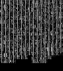

### gcUnknownD13C01

132 bytes compressed, 2048 decompressed.
Nothing in the source names it (found between other streams).

### gcUnknownD13D09

1573 bytes compressed, 4096 decompressed.
- Entry `aDecompressionDMAEntry80B626` (build.asm:811): $1000 bytes to VRAM $3000; used by `rlUnknown80B452` (engine/unsorted/bank80.asm:4859).

### gcUnknownD1432E

71 bytes compressed, 256 decompressed.
- Entry `aDecompressionDMAEntry80B62E` (build.asm:812): $0100 bytes to VRAM $4000; used by `rlUnknown80B452` (engine/unsorted/bank80.asm:4876).

### gcUnknownD14375

281 bytes compressed, 2048 decompressed.
- Entry `aDecompressionDMAEntry80B636` (build.asm:813): $0800 bytes to VRAM $6000; used by `rlUnknown80B452` (engine/unsorted/bank80.asm:4885).

### gcUnknownD1448E

5418 bytes compressed, 16384 decompressed.
Nothing in the source names it (found between other streams).

### gcUnknownD159B8

328 bytes compressed, 2048 decompressed.
Nothing in the source names it (found between other streams).

### gcUnknownD15B00

365 bytes compressed, 704 decompressed.
Nothing in the source names it (found between other streams).

### gcUnknownD15C6D

5974 bytes compressed, 16384 decompressed.
Nothing in the source names it (found between other streams).

### gcUnknownD173C3

397 bytes compressed, 704 decompressed.
Nothing in the source names it (found between other streams).

### gcUnknownD17550

1841 bytes compressed, 8192 decompressed.
Nothing in the source names it (found between other streams).

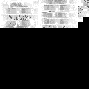

### gcUnknownD17C81

4182 bytes compressed, 16384 decompressed.
Nothing in the source names it (found between other streams).

### gcUnknownD20CD7

264 bytes compressed, 2048 decompressed.
Nothing in the source names it (found between other streams).

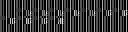

### gcUnknownD20DDF

276 bytes compressed, 704 decompressed.
Nothing in the source names it (found between other streams).

### gcUnknownD20EF3

1392 bytes compressed, 8192 decompressed.
Nothing in the source names it (found between other streams).

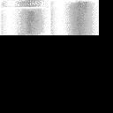

### gcUnknownD21463

3325 bytes compressed, 16384 decompressed.
Nothing in the source names it (found between other streams).

### gcUnknownD22160

273 bytes compressed, 2048 decompressed.
Nothing in the source names it (found between other streams).

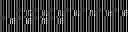

### gcUnknownD22271

447 bytes compressed, 704 decompressed.
Nothing in the source names it (found between other streams).

### gcUnknownD22430

2011 bytes compressed, 4096 decompressed.
- Entry `aDecompressionDMAEntry8ABF0F` (build.asm:8503): $1000 bytes to VRAM $0000; used by `rsUnknown8ABE63` (engine/unsorted/bank8A.asm:7681).

### gcUnknownD22C0B

5285 bytes compressed, 8192 decompressed.
- Entry `aDecompressionDMAEntry8AEE99` (build.asm:8961): $2000 bytes to VRAM $1000; used by `rlUnknown8AECEF` (engine/unsorted/bank8A.asm:12009).

### gcUnknownD240B0

2148 bytes compressed, 4096 decompressed.
- Entry `aDecompressionDMAEntry8AEE91` (build.asm:8960): $1000 bytes to VRAM $0000; used by `rlUnknown8AECEF` (engine/unsorted/bank8A.asm:12004).

### gcUnknownD24914

912 bytes compressed, 2048 decompressed.
- Entry `aDecompressionDMAEntry8AEEA1` (build.asm:8962): $0800 bytes to VRAM $2800; used by `rlUnknown8AECEF` (engine/unsorted/bank8A.asm:12022).

### gcUnknownD24CA4

7509 bytes compressed, 8192 decompressed.
- Entry `aDecompressionDMAEntry8AFA1C` (build.asm:9063): $2000 bytes to VRAM $1000; used by `rlUnknown8AF894` (engine/unsorted/bank8A.asm:13643).

### gcUnknownD269F9

2240 bytes compressed, 4096 decompressed.
- Entry `aDecompressionDMAEntry8AFA14` (build.asm:9062): $1000 bytes to VRAM $0000; used by `rlUnknown8AF894` (engine/unsorted/bank8A.asm:13638).

### gcUnknownD272B9

995 bytes compressed, 2048 decompressed.
- Entry `aDecompressionDMAEntry8AFA24` (build.asm:9064): $0800 bytes to VRAM $2800; used by `rlUnknown8AF894` (engine/unsorted/bank8A.asm:13652).

### gcUnknownD2769C

2174 bytes compressed, 4096 decompressed.
- Entry `aDecompressionDMAEntry8ABF1F` (build.asm:8505): $1000 bytes to VRAM $0000; used by `rsUnknown8ABE63` (engine/unsorted/bank8A.asm:7737).

### gcUnknownD27F1A

1980 bytes compressed, 4096 decompressed.
- Entry `aDecompressionDMAEntry8ABF17` (build.asm:8504): $1000 bytes to VRAM $0000; used by `rsUnknown8ABE63` (engine/unsorted/bank8A.asm:7709).

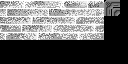

### gcUnknownD306D6

2174 bytes compressed, 4096 decompressed.
- Entry `aUnknown8AE4C3` (engine/arena/arena.asm:32): $1000 bytes to VRAM $0000; used by `rlUnknown8AE2F8` (engine/unsorted/bank8A.asm:11815).

### gcUnknownD30F54

2124 bytes compressed, 4096 decompressed.
- Entry `aDecompressionDMAEntry8AF26B` (build.asm:9008): $1000 bytes to VRAM $0000; used by `rlUnknown8AF0F2` (engine/unsorted/bank8A.asm:12562).

### gcUnknownD317A0

5419 bytes compressed, 8192 decompressed.
- Entry `aDecompressionDMAEntry80EFB0` (build.asm:1289): $2000 bytes to VRAM $2000; used by `rlUnknown80EE37` (engine/unsorted/bank80.asm:7597).

### gcUnknownD32CCB

965 bytes compressed, 4096 decompressed.
- Entry `aDecompressionDMAEntry80EFC0` (build.asm:1291): $1000 bytes to VRAM $6000; used by `rlUnknown80EE37` (engine/unsorted/bank80.asm:7617).

### gcUnknownD33090

1317 bytes compressed, 4096 decompressed.
- Entry `aDecompressionDMAEntry80EFC8` (build.asm:1292): $1000 bytes to VRAM $5000; used by `rlUnknown80EE37` (engine/unsorted/bank80.asm:7607).

### gcUnknownD335B5

2373 bytes compressed, 4096 decompressed.
- Entry `aDecompressionDMAEntry80EFD0` (build.asm:1293): $1000 bytes to VRAM $5800; used by `rlUnknown80EE37` (engine/unsorted/bank80.asm:7612).

### gcUnknownD33EFA

7238 bytes compressed, 8192 decompressed.
- Entry `aDecompressionDMAEntry80BB55` (build.asm:931): $2000 bytes to VRAM $1000; used by `rlUnknown80BA52` (engine/unsorted/bank80.asm:5672).

### gcUnknownD35B40

884 bytes compressed, 2048 decompressed.
- Entry `aDecompressionDMAEntry80BB4D` (build.asm:930): $0800 bytes to VRAM $5400; used by `rlUnknown80BA52` (engine/unsorted/bank80.asm:5677).

### gcUnknownD35EB4

17210 bytes compressed, 22528 decompressed.
- Entry `aDecompressionDMAEntry80F197` (build.asm:1310): $5800 bytes to VRAM $0000; used by `rlUnknown80EFD8` (engine/unsorted/bank80.asm:7800).
- Entry `aDecompressionDMAEntry8DAF95` (build.asm:10309): $3000 bytes to VRAM $0000; used by `rlUnknown8DAF33` (engine/unsorted/bank8D.asm:1354).

### gcUnknownD421EE

133 bytes compressed, 2048 decompressed.
- Entry `aDecompressionDMAEntry8DAF9D` (build.asm:10310): $0800 bytes to VRAM $5800; used by `rlUnknown8DAF33` (engine/unsorted/bank8D.asm:1359).

### gcUnknownD42273

1605 bytes compressed, 4096 decompressed.
- Entry `aDecompressionDMAEntry8DB066` (build.asm:10327): $1000 bytes to VRAM $4000; used by `rlUnknown8DAFA5` (engine/unsorted/bank8D.asm:1420).

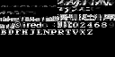

### gcUnknownD428B8

318 bytes compressed, 2048 decompressed.
- Entry `aDecompressionDMAEntry8DB05E` (build.asm:10326): $0800 bytes to VRAM $6800; used by nothing named.

### gcUnknownD429F6

602 bytes compressed, 2048 decompressed.
- Entry `aDecompressionDMAEntry8DB056` (build.asm:10325): $0800 bytes to VRAM $5800; used by `rlUnknown8DAFA5` (engine/unsorted/bank8D.asm:1415).

### gcUnknownD42C50

1970 bytes compressed, 4096 decompressed.
- Entry `aDecompressionDMAEntry80F19F` (build.asm:1311): $1000 bytes to VRAM $5800; used by `rlUnknown80EFD8` (engine/unsorted/bank80.asm:7805).

### gcUnknownD43402

3393 bytes compressed, 4096 decompressed.
Nothing in the source names it (found between other streams).

### gcUnknownD44143

344 bytes compressed, 2048 decompressed.
Nothing in the source names it (found between other streams).

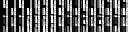

### gcUnknownD4429B

1492 bytes compressed, 2048 decompressed.
Nothing in the source names it (found between other streams).

### gcUnknownD4486F

301 bytes compressed, 2048 decompressed.
Nothing in the source names it (found between other streams).

### gcUnknownD4499C

6316 bytes compressed, 12288 decompressed.
Nothing in the source names it (found between other streams).

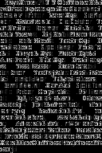

### gcUnknownD46248

58 bytes compressed, 1792 decompressed.
Nothing in the source names it (found between other streams).

### gcUnknownD46282

132 bytes compressed, 1792 decompressed.
Nothing in the source names it (found between other streams).

### gcUnknownD46306

131 bytes compressed, 1792 decompressed.
Nothing in the source names it (found between other streams).

### gcUnknownD46389

134 bytes compressed, 1792 decompressed.
Nothing in the source names it (found between other streams).

### gcUnknownD4640F

198 bytes compressed, 1792 decompressed.
Nothing in the source names it (found between other streams).

### gcUnknownD464D5

147 bytes compressed, 1792 decompressed.
Nothing in the source names it (found between other streams).

### gcUnknownD46568

264 bytes compressed, 1792 decompressed.
Nothing in the source names it (found between other streams).

### gcUnknownD46670

33 bytes compressed, 1792 decompressed.
Nothing in the source names it (found between other streams).

### gcUnknownD46691

350 bytes compressed, 2048 decompressed.
- Entry `aUnknown8AE4CB` (engine/arena/arena.asm:38): $0800 bytes to VRAM $2800; used by `rlUnknown8AE2F8` (engine/unsorted/bank8A.asm:11828).
- Entry `aDecompressionDMAEntry8ABE53` (build.asm:8487): $0800 bytes to VRAM $2800; used by `rlUnknown8ABCF8` (engine/unsorted/bank8A.asm:7557).
- Entry `aDecompressionDMAEntry8AF273` (build.asm:9009): $0800 bytes to VRAM $2800; used by `rlUnknown8AF0F2` (engine/unsorted/bank8A.asm:12575).

### gcUnknownD467EF

180 bytes compressed, 2048 decompressed.
- Entry `aUnknown8AE4D3` (engine/arena/arena.asm:44): $0800 bytes to VRAM $2C00; used by `rlUnknown8AE2F8` (engine/unsorted/bank8A.asm:11833).
- Entry `aDecompressionDMAEntry8ABE5B` (build.asm:8488): $0800 bytes to VRAM $2C00; used by `rlUnknown8ABCF8` (engine/unsorted/bank8A.asm:7562).
- Entry `aDecompressionDMAEntry8AEEA9` (build.asm:8963): $0800 bytes to VRAM $2C00; used by `rlUnknown8AECEF` (engine/unsorted/bank8A.asm:12027).
- Entry `aDecompressionDMAEntry8AF27B` (build.asm:9010): $0800 bytes to VRAM $2C00; used by `rlUnknown8AF0F2` (engine/unsorted/bank8A.asm:12580).
- Entry `aDecompressionDMAEntry8AFA2C` (build.asm:9065): $0800 bytes to VRAM $2C00; used by `rlUnknown8AF894` (engine/unsorted/bank8A.asm:13657).

## Region $D50000

### gcUnknownD531ED

381 bytes compressed, 512 decompressed.
Nothing in the source names it (found between other streams).

### gcUnknownD5336A

370 bytes compressed, 512 decompressed.
Nothing in the source names it (found between other streams).

### gcUnknownD534DC

121 bytes compressed, 512 decompressed.
Nothing in the source names it (found between other streams).

### gcUnknownD53555

111 bytes compressed, 512 decompressed.
Nothing in the source names it (found between other streams).

### gcUnknownD535C4

107 bytes compressed, 512 decompressed.
Nothing in the source names it (found between other streams).

### gcUnknownD5362F

65 bytes compressed, 512 decompressed.
Nothing in the source names it (found between other streams).

### gcUnknownD53670

72 bytes compressed, 512 decompressed.
Nothing in the source names it (found between other streams).

### gcUnknownD536B8

72 bytes compressed, 512 decompressed.
Nothing in the source names it (found between other streams).

### gcUnknownD53700

397 bytes compressed, 512 decompressed.
Nothing in the source names it (found between other streams).

### gcUnknownD5388D

369 bytes compressed, 512 decompressed.
Nothing in the source names it (found between other streams).

### gcUnknownD539FE

370 bytes compressed, 512 decompressed.
Nothing in the source names it (found between other streams).

### gcUnknownD53B70

399 bytes compressed, 512 decompressed.
Nothing in the source names it (found between other streams).

### gcUnknownD53CFF

147 bytes compressed, 512 decompressed.
Nothing in the source names it (found between other streams).

### gcUnknownD53D92

90 bytes compressed, 512 decompressed.
Nothing in the source names it (found between other streams).

### gcUnknownD53DEC

110 bytes compressed, 512 decompressed.
Nothing in the source names it (found between other streams).

### gcUnknownD53E5A

115 bytes compressed, 512 decompressed.
Nothing in the source names it (found between other streams).

### gcUnknownD53ECD

379 bytes compressed, 512 decompressed.
Nothing in the source names it (found between other streams).

### gcUnknownD54048

379 bytes compressed, 512 decompressed.
Nothing in the source names it (found between other streams).

### gcUnknownD541C3

365 bytes compressed, 512 decompressed.
Nothing in the source names it (found between other streams).

### gcUnknownD54330

72 bytes compressed, 512 decompressed.
Nothing in the source names it (found between other streams).

### gcUnknownD54378

143 bytes compressed, 512 decompressed.
Nothing in the source names it (found between other streams).

### gcUnknownD54407

29 bytes compressed, 512 decompressed.
Nothing in the source names it (found between other streams).

### gcUnknownD54424

93 bytes compressed, 512 decompressed.
Nothing in the source names it (found between other streams).

### gcUnknownD54481

369 bytes compressed, 512 decompressed.
Nothing in the source names it (found between other streams).

### gcUnknownD545F2

370 bytes compressed, 512 decompressed.
Nothing in the source names it (found between other streams).

### gcUnknownD54764

362 bytes compressed, 512 decompressed.
Nothing in the source names it (found between other streams).

### gcUnknownD548CE

72 bytes compressed, 512 decompressed.
Nothing in the source names it (found between other streams).

### gcUnknownD54916

39 bytes compressed, 512 decompressed.
Nothing in the source names it (found between other streams).

### gcUnknownD5493D

369 bytes compressed, 512 decompressed.
Nothing in the source names it (found between other streams).

### gcUnknownD54AAE

369 bytes compressed, 512 decompressed.
Nothing in the source names it (found between other streams).

### gcUnknownD54C1F

370 bytes compressed, 512 decompressed.
Nothing in the source names it (found between other streams).

### gcUnknownD54D91

72 bytes compressed, 512 decompressed.
Nothing in the source names it (found between other streams).

### gcUnknownD54DD9

135 bytes compressed, 512 decompressed.
Nothing in the source names it (found between other streams).

### gcUnknownD54E60

71 bytes compressed, 512 decompressed.
Nothing in the source names it (found between other streams).

### gcUnknownD54EA7

99 bytes compressed, 512 decompressed.
Nothing in the source names it (found between other streams).

### gcUnknownD54F0A

39 bytes compressed, 512 decompressed.
Nothing in the source names it (found between other streams).

### gcUnknownD54F31

72 bytes compressed, 512 decompressed.
Nothing in the source names it (found between other streams).

### gcUnknownD54F79

70 bytes compressed, 512 decompressed.
Nothing in the source names it (found between other streams).

### gcUnknownD54FBF

370 bytes compressed, 512 decompressed.
Nothing in the source names it (found between other streams).

### gcUnknownD55131

381 bytes compressed, 512 decompressed.
Nothing in the source names it (found between other streams).

### gcUnknownD552AE

370 bytes compressed, 512 decompressed.
Nothing in the source names it (found between other streams).

### gcUnknownD55420

370 bytes compressed, 512 decompressed.
Nothing in the source names it (found between other streams).

### gcUnknownD55592

370 bytes compressed, 512 decompressed.
Nothing in the source names it (found between other streams).

### gcUnknownD55704

370 bytes compressed, 512 decompressed.
Nothing in the source names it (found between other streams).

### gcUnknownD55876

369 bytes compressed, 512 decompressed.
Nothing in the source names it (found between other streams).

### gcUnknownD559E7

407 bytes compressed, 4096 decompressed.
Nothing in the source names it (found between other streams).

### gcUnknownD55B7E

256 bytes compressed, 4096 decompressed.
Nothing in the source names it (found between other streams).

### gcUnknownD55C7E

999 bytes compressed, 4096 decompressed.
Nothing in the source names it (found between other streams).

### gcUnknownD56065

497 bytes compressed, 4096 decompressed.
Nothing in the source names it (found between other streams).

### gcUnknownD56256

689 bytes compressed, 4096 decompressed.
Nothing in the source names it (found between other streams).

### gcUnknownD56507

677 bytes compressed, 4096 decompressed.
Nothing in the source names it (found between other streams).

### gcUnknownD567AC

204 bytes compressed, 4096 decompressed.
Nothing in the source names it (found between other streams).

### gcUnknownD56878

230 bytes compressed, 4096 decompressed.
Nothing in the source names it (found between other streams).

### gcUnknownD5695E

617 bytes compressed, 4096 decompressed.
Nothing in the source names it (found between other streams).

### gcUnknownD56BC7

182 bytes compressed, 4096 decompressed.
Nothing in the source names it (found between other streams).

### gcUnknownD56C7D

186 bytes compressed, 4096 decompressed.
Nothing in the source names it (found between other streams).

### gcUnknownD56D37

1298 bytes compressed, 4096 decompressed.
Nothing in the source names it (found between other streams).

### gcUnknownD57249

531 bytes compressed, 4096 decompressed.
Nothing in the source names it (found between other streams).

### gcUnknownD5745C

764 bytes compressed, 4096 decompressed.
Nothing in the source names it (found between other streams).

### gcUnknownD57758

604 bytes compressed, 4096 decompressed.
Nothing in the source names it (found between other streams).

### gcUnknownD579B4

120 bytes compressed, 4096 decompressed.
Nothing in the source names it (found between other streams).

### gcUnknownD57A2C

111 bytes compressed, 4096 decompressed.
Nothing in the source names it (found between other streams).

### gcUnknownD57A9B

181 bytes compressed, 4096 decompressed.
Nothing in the source names it (found between other streams).

### gcUnknownD57B50

2190 bytes compressed, 4096 decompressed.
Nothing in the source names it (found between other streams).

### gcUnknownD603DE

1979 bytes compressed, 4096 decompressed.
Nothing in the source names it (found between other streams).

### gcUnknownD60B99

38 bytes compressed, 4096 decompressed.
Nothing in the source names it (found between other streams).

### gcUnknownD60BBF

388 bytes compressed, 4096 decompressed.
Nothing in the source names it (found between other streams).

### gcUnknownD60D43

2582 bytes compressed, 4096 decompressed.
Nothing in the source names it (found between other streams).

### gcUnknownD61759

72 bytes compressed, 4096 decompressed.
Nothing in the source names it (found between other streams).

### gcUnknownD617A1

154 bytes compressed, 2048 decompressed.
Nothing in the source names it (found between other streams).

### gcUnknownD6183B

471 bytes compressed, 2048 decompressed.
Nothing in the source names it (found between other streams).

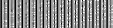

### gcUnknownD61A12

497 bytes compressed, 2048 decompressed.
Nothing in the source names it (found between other streams).

### gcUnknownD61C03

177 bytes compressed, 2048 decompressed.
Nothing in the source names it (found between other streams).

### gcUnknownD61CB4

184 bytes compressed, 2048 decompressed.
Nothing in the source names it (found between other streams).

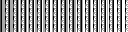

### gcUnknownD61D6C

184 bytes compressed, 2048 decompressed.
- `rlUnknown9F850B` (engine/unsorted/bank9F.asm:632): `lda #(`gcUnknownD61D6C)<<8`

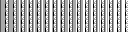

### gcUnknownD61E24

171 bytes compressed, 2048 decompressed.
Nothing in the source names it (found between other streams).

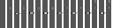

### gcUnknownD61ECF

171 bytes compressed, 2048 decompressed.
- `rlUnknown9F850B` (engine/unsorted/bank9F.asm:618): `lda #(`gcUnknownD61ECF)<<8`

### gcUnknownD61F7A

174 bytes compressed, 2048 decompressed.
Nothing in the source names it (found between other streams).

### gcUnknownD62028

166 bytes compressed, 2048 decompressed.
Nothing in the source names it (found between other streams).

### gcUnknownD620CE

353 bytes compressed, 2048 decompressed.
Nothing in the source names it (found between other streams).

### gcUnknownD6222F

135 bytes compressed, 2048 decompressed.
Nothing in the source names it (found between other streams).

### gcUnknownD622B6

166 bytes compressed, 2048 decompressed.
Nothing in the source names it (found between other streams).

### gcUnknownD6235C

527 bytes compressed, 2048 decompressed.
Nothing in the source names it (found between other streams).

### gcUnknownD6256B

272 bytes compressed, 2048 decompressed.
Nothing in the source names it (found between other streams).

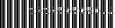

### gcUnknownD6267B

237 bytes compressed, 2048 decompressed.
Nothing in the source names it (found between other streams).

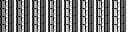

### gcUnknownD62768

154 bytes compressed, 2048 decompressed.
Nothing in the source names it (found between other streams).

### gcUnknownD62802

129 bytes compressed, 2048 decompressed.
Nothing in the source names it (found between other streams).

### gcUnknownD62883

135 bytes compressed, 2048 decompressed.
Nothing in the source names it (found between other streams).

### gcUnknownD6290A

167 bytes compressed, 2048 decompressed.
Nothing in the source names it (found between other streams).

### gcUnknownD629B1

684 bytes compressed, 2048 decompressed.
Nothing in the source names it (found between other streams).

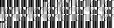

### gcUnknownD62C5D

623 bytes compressed, 2048 decompressed.
Nothing in the source names it (found between other streams).

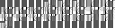

### gcUnknownD62ECC

109 bytes compressed, 2048 decompressed.
Nothing in the source names it (found between other streams).

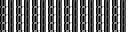

### gcUnknownD62F39

183 bytes compressed, 2048 decompressed.
Nothing in the source names it (found between other streams).

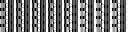

### gcUnknownD62FF0

636 bytes compressed, 2048 decompressed.
Nothing in the source names it (found between other streams).

### gcUnknownD6326C

383 bytes compressed, 2048 decompressed.
Nothing in the source names it (found between other streams).

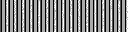

### gcUnknownD633EB

556 bytes compressed, 1024 decompressed.
Nothing in the source names it (found between other streams).

### gcUnknownD63617

278 bytes compressed, 1024 decompressed.
Nothing in the source names it (found between other streams).

### gcUnknownD6372D

397 bytes compressed, 1024 decompressed.
Nothing in the source names it (found between other streams).

### gcUnknownD638BA

518 bytes compressed, 1024 decompressed.
Nothing in the source names it (found between other streams).

### gcUnknownD63AC0

223 bytes compressed, 1024 decompressed.
Nothing in the source names it (found between other streams).

### gcUnknownD63B9F

697 bytes compressed, 1024 decompressed.
Nothing in the source names it (found between other streams).

### gcUnknownD63E58

566 bytes compressed, 1024 decompressed.
Nothing in the source names it (found between other streams).

### gcUnknownD6408E

438 bytes compressed, 1024 decompressed.
Nothing in the source names it (found between other streams).

### gcUnknownD64244

410 bytes compressed, 1024 decompressed.
Nothing in the source names it (found between other streams).

### gcUnknownD643DE

277 bytes compressed, 1024 decompressed.
Nothing in the source names it (found between other streams).

### gcUnknownD644F3

474 bytes compressed, 1024 decompressed.
Nothing in the source names it (found between other streams).

### gcUnknownD646CD

615 bytes compressed, 1024 decompressed.
Nothing in the source names it (found between other streams).

### gcUnknownD64934

698 bytes compressed, 1024 decompressed.
Nothing in the source names it (found between other streams).

### gcUnknownD64BEE

352 bytes compressed, 1024 decompressed.
Nothing in the source names it (found between other streams).

### gcUnknownD64D4E

706 bytes compressed, 1024 decompressed.
Nothing in the source names it (found between other streams).

### gcUnknownD65010

323 bytes compressed, 1024 decompressed.
Nothing in the source names it (found between other streams).

### gcUnknownD65153

111 bytes compressed, 1024 decompressed.
Nothing in the source names it (found between other streams).

### gcUnknownD651C2

567 bytes compressed, 1024 decompressed.
Nothing in the source names it (found between other streams).

### gcUnknownD653F9

594 bytes compressed, 1024 decompressed.
Nothing in the source names it (found between other streams).

### gcUnknownD6564B

133 bytes compressed, 1024 decompressed.
Nothing in the source names it (found between other streams).

### gcUnknownD656D0

608 bytes compressed, 1024 decompressed.
Nothing in the source names it (found between other streams).

### gcUnknownD65930

713 bytes compressed, 1024 decompressed.
Nothing in the source names it (found between other streams).

### gcUnknownD65BF9

788 bytes compressed, 1024 decompressed.
Nothing in the source names it (found between other streams).

### gcUnknownD676F6

243 bytes compressed, 1024 decompressed.
- `rlUnknown9E9D3B` (engine/unsorted/bank9E.asm:4706): `lda #(`gcUnknownD676F6)<<8`

### gcUnknownD677E9

87 bytes compressed, 2048 decompressed.
- `rlUnknown9E9D3B` (engine/unsorted/bank9E.asm:4718): `lda #(`gcUnknownD677E9)<<8`

### gcUnknownD67840

324 bytes compressed, 1024 decompressed.
Nothing in the source names it (found between other streams).

### gcUnknownD67984

578 bytes compressed, 1024 decompressed.
Nothing in the source names it (found between other streams).

### gcUnknownD67BC6

257 bytes compressed, 1024 decompressed.
Nothing in the source names it (found between other streams).

### gcUnknownD67CC7

182 bytes compressed, 1024 decompressed.
Nothing in the source names it (found between other streams).

### gcUnknownD67D7D

414 bytes compressed, 2048 decompressed.
Nothing in the source names it (found between other streams).

## Region $DD0000

### gcUnknownDD0000

8352 bytes compressed, 9728 decompressed.
- `rsUnknown898105` (engine/unsorted/bank89.asm:385): `lda #(`gcUnknownDD0000)<<8`
- `rsUnknown89831F` (engine/unsorted/bank89.asm:635): `lda #(`gcUnknownDD0000)<<8`

### gcUnknownDD20A0

3150 bytes compressed, 4608 decompressed.
- Entry `aUnknown80E146` (engine/menus/revive_screen.asm:223): $1200 bytes to VRAM $3000; used by `rsUnknown80E0AE` (engine/menus/revive_screen.asm:159).
- Entry `aDecompressionDMAEntry80F187` (build.asm:1308): $1200 bytes to VRAM $3000; used by `rlUnknown80EFD8` (engine/unsorted/bank80.asm:7790).
- Entry `aDecompressionDMAEntry80F433` (build.asm:1376): $1200 bytes to VRAM $4000; used by `rsUnknown80F392` (engine/unsorted/bank80.asm:8253).

### gcUnknownDD2CEE

162 bytes compressed, 1792 decompressed.
- Entry `aUnknown80E14E` (engine/menus/revive_screen.asm:228): $0700 bytes to VRAM $1800; used by `rsUnknown80E0AE` (engine/menus/revive_screen.asm:198).

### gcUnknownDD2D90

699 bytes compressed, 2048 decompressed.
- Entry `aUnknown80E156` (engine/menus/revive_screen.asm:233): $0800 bytes to VRAM $2000; used by `rsUnknown80E0AE` (engine/menus/revive_screen.asm:203).
- Entry `aDecompressionDMAEntry80F18F` (build.asm:1309): $0800 bytes to VRAM $5000; used by `rlUnknown80EFD8` (engine/unsorted/bank80.asm:7795).
- Entry `aDecompressionDMAEntry80F43B` (build.asm:1377): $0800 bytes to VRAM $6000; used by `rsUnknown80F392` (engine/unsorted/bank80.asm:8301).

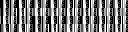

### gcUnknownDD304B

1775 bytes compressed, 2048 decompressed.
- `rsDataWindowLoadBanners` (engine/menus/data_window.asm:804): `lda #(`gcUnknownDD304B)<<8`

### gcUnknownDD373A

279 bytes compressed, 1792 decompressed.
- `rsDataWindowLoadGraphics` (engine/menus/data_window.asm:151): `lda #(`gcUnknownDD373A)<<8`

### gcUnknownDD3851

225 bytes compressed, 1216 decompressed.
- `rsDataWindowLoadGraphics` (engine/menus/data_window.asm:160): `lda #(`gcUnknownDD3851)<<8`

### gcUnknownDD3932

684 bytes compressed, 2048 decompressed.
- Entry `aDecompressionDMAEntry80E736` (build.asm:1230): $0800 bytes to VRAM $4200; used by `rsUnknown80E6C9` (engine/unsorted/bank80.asm:7182).

### gcUnknownDD3BDE

262 bytes compressed, 1792 decompressed.
- Entry `aDecompressionDMAEntry80E73E` (build.asm:1231): $0700 bytes to VRAM $2000; used by `rsUnknown80E6C9` (engine/unsorted/bank80.asm:7197).

### gcUnknownDD3CE4

220 bytes compressed, 1792 decompressed.
- Entry `aDecompressionDMAEntry80D425` (build.asm:1163): $0700 bytes to VRAM $1800; used by `rsSkillWindowCopyGraphics` (engine/menus/skill_window.asm:161).

### gcUnknownDD3DC0

214 bytes compressed, 1792 decompressed.
- `rsItemWindowCopyGraphics` (engine/menus/item_window.asm:151): `lda #(`gcUnknownDD3DC0)<<8`

### gcUnknownDD3E96

138 bytes compressed, 704 decompressed.
- `rsItemWindowCopyGraphics` (engine/menus/item_window.asm:160): `lda #(`gcUnknownDD3E96)<<8`

### gcUnknownDD3F20

134 bytes compressed, 2048 decompressed.
- Entry `aUnknown80E545` (engine/unsorted/bank80.asm:6983): $0800 bytes to VRAM $6000; used by `rsUnknown80E4EB` (engine/unsorted/bank80.asm:6966).
- Entry `aDecompressionDMAEntry80CE96` (build.asm:1112): $0800 bytes to VRAM $2800; used by `rsItemWindowCopyGraphics` (engine/menus/item_window.asm:173).
- Entry `aDecompressionDMAEntry80D42D` (build.asm:1164): $0800 bytes to VRAM $2000; used by `rsSkillWindowCopyGraphics` (engine/menus/skill_window.asm:166).

### gcUnknownDD3FA6

8952 bytes compressed, 16384 decompressed.
- Entry `aDecompressionDMAEntry80F42B` (build.asm:1375): $4000 bytes to VRAM $0000; used by `rsUnknown80F392` (engine/unsorted/bank80.asm:8248).

### gcUnknownDD629E

951 bytes compressed, 2304 decompressed.
- `rsUnknown80F392` (engine/unsorted/bank80.asm:8280): `lda #(`gcUnknownDD629E)<<8`

## Region $DF3192

### gcUnknownDF3192

13295 bytes compressed, 16384 decompressed.
- Entry `aDecompressionDMAEntry80EFA8` (build.asm:1288): $4000 bytes to VRAM $0000; used by `rlUnknown80EE37` (engine/unsorted/bank80.asm:7592).

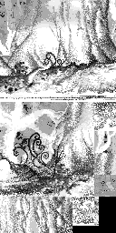

### gcUnknownDF6581

1024 bytes compressed, 4096 decompressed.
Nothing in the source names it (found between other streams).

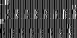

### gcUnknownDF6981

1657 bytes compressed, 4096 decompressed.
Nothing in the source names it (found between other streams).

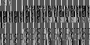

### gcUnknownDF6FFA

4094 bytes compressed, 7488 decompressed.
Nothing in the source names it (found between other streams).

## Region $F623D3

### gcUnknownF623D3

5721 bytes compressed, 7200 decompressed.
- Entry `aDecompressionDMAEntry80EFB8` (build.asm:1290): $2000 bytes to VRAM $3000; used by `rlUnknown80EE37` (engine/unsorted/bank80.asm:7602).

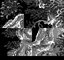

### gcUnknownF63A2C

44 bytes compressed, 128 decompressed.
Nothing in the source names it (found between other streams).

### gcUnknownF63A58

53 bytes compressed, 128 decompressed.
Nothing in the source names it (found between other streams).

### gcUnknownF63A8D

59 bytes compressed, 128 decompressed.
Nothing in the source names it (found between other streams).

### gcUnknownF63AC8

51 bytes compressed, 128 decompressed.
Nothing in the source names it (found between other streams).

### gcUnknownF63AFB

62 bytes compressed, 128 decompressed.
Nothing in the source names it (found between other streams).

### gcUnknownF63B39

55 bytes compressed, 128 decompressed.
Nothing in the source names it (found between other streams).

### gcUnknownF63B70

62 bytes compressed, 128 decompressed.
Nothing in the source names it (found between other streams).

### gcUnknownF63BAE

62 bytes compressed, 128 decompressed.
Nothing in the source names it (found between other streams).

### gcUnknownF63BEC

31 bytes compressed, 128 decompressed.
Nothing in the source names it (found between other streams).

### gcUnknownF63C0B

1105 bytes compressed, 4096 decompressed.
Nothing in the source names it (found between other streams).

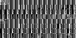

### gcUnknownF6405C

1135 bytes compressed, 4096 decompressed.
Nothing in the source names it (found between other streams).

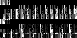

### gcUnknownF644CB

718 bytes compressed, 4096 decompressed.
Nothing in the source names it (found between other streams).

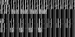

### gcUnknownF64799

12133 bytes compressed, 16384 decompressed.
Nothing in the source names it (found between other streams).

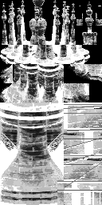

### gcUnknownF676FE

13781 bytes compressed, 16384 decompressed.
Nothing in the source names it (found between other streams).

### gcUnknownF72CD3

1225 bytes compressed, 4096 decompressed.
Nothing in the source names it (found between other streams).

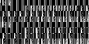

### gcUnknownF7319C

10488 bytes compressed, 16384 decompressed.
Nothing in the source names it (found between other streams).

### gcUnknownF75A94

1053 bytes compressed, 4096 decompressed.
Nothing in the source names it (found between other streams).

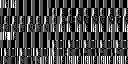

### gcUnknownF75EB1

7447 bytes compressed, 16384 decompressed.
Nothing in the source names it (found between other streams).

